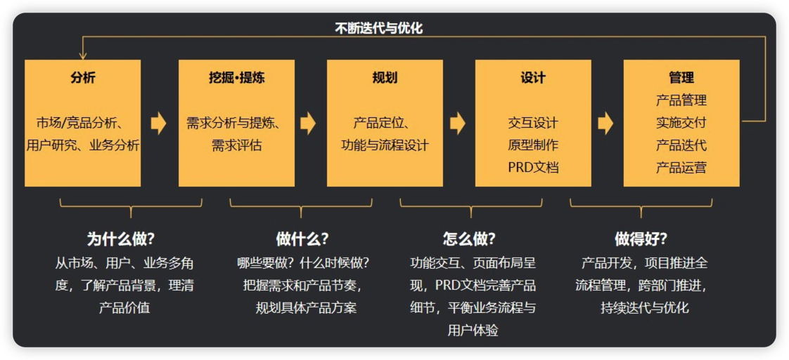
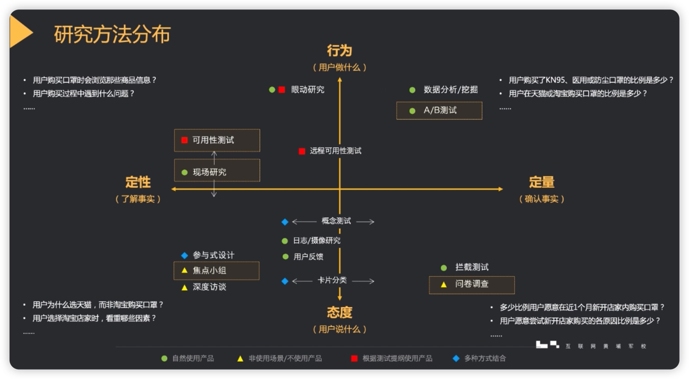

[[toc]]

# 一、定义
帮助定义产品的目标用户群，明确细化产品概念，并通过对用户的任务操作特性、知觉特性、认知心理特征的研究，使用户的实际需求成为产品设计的导向，使您的产品更符合用户的习惯、经验和期待。
比如：
- 用户群体特征：
  - 性别、年龄、职业、使用经验……
- 行为模式：
  - 目前用什么工具和信息？
  - 执行步骤是什么样的？
  - 时间？地点？频率如何？
  - 与哪些人接触、合作？
  - ……
- 观点
  - 为什么这样？
  - 过程中有什么不爽？比较爽的是什么？
  - ……
## 何时做用户研究？

**不要站在你的立场，而是要站在用户的立场！**
# 二、用户研究方法概述
用户研究过程：指利用有计划的、系统性的资料收集、分析和解释的方法获得解决问题的过程。
## 用户研究流程
### 提出问题
了解问题、目标，了解研究内容
比如：
- 业务问题是什么？
- 为什么有这个业务问题？
- 关于这个已知什么？
- 这个业务和谁有关？
- 这个业务问题怎么回答？
- 怎么转化成研究问题？
- 5WH？
- ……
### 选取方法
根据问题、目标，选择合适的方法
- 选择什么研究方法？
- 选取哪类特征用户？
- 该选择多少用户量？
- ……
### 收集数据
研究过程中，需要收集对应的数据
- 有效的数据是什么？
- 数据怎么收集？
- 怎么评价数据质量？
- ……
### 分析数据
做数据的清洗、分析
- 规律是什么？
- 差异点是什么？
- 因果关系是什么？
- ……
### 解决问题
根据上述的得到的数据，总结分析，得出问题的解决方案
- 问题该如何解决？
- 谁负责解决？
- 解决排期是怎么样的？
- ……
## 定性研究VS定量研究
### 定量研究
将实际问题转为数字指标，通过统计汇总，以数据支持描述现象、验证假设，但无法追溯背后具体深度原因。
主要的方法有：
- 问卷调查
- A/B 测试
- 数据挖掘、分析
### 定性研究
主要用于收集用户真实的行为和想法，深度理解和挖掘，从而验证分析前的猜想，但无法推及总体量级。
主要的方法有：
- 深度访谈
- 焦点小组
- 可用性测试
- 现场研究

## 可用性测试
具有代表性的用户使用产品完成典型任务操作，**获取用户的行为和想法，从而找到产品可用性问题，指导迭代优化**。
- 评估产品：使用中常见问题，为什么无法完成任务？
- 比较竞品：方案 A 和方案 B 的优缺点，以及迭代后产品的使用是否有改进？
- 探索方向：新功能是否满足使用场景？
## 焦点小组
通过邀请一组用户（通常6至9名用户）共同讨论关于某一个特定的话题（诸如产品、想法、概念等），**了解目标人群的愿望、动机、态度和看法**。
- 优势：短期内获得大量数据，组员间更容易互相激发和达成共识，适用范围交广：探索性、确认优先级、比较竞品、发现趋势
- 劣势：无法获得用户行为数据，无法了解某个特定任务细节，无法获得定量数据
## 现场研究
人类学的基本方法论，实地参与现场调查研究
“参与当地人的生活，在一个有一个严格定义的空间和时间的范围内，体验人们的日常生活与思想境界，通过记录人的生活的方方面面，来展示不同文化如何满足人的普遍的基本需求、社会如何构成。“
## 问卷调查
问卷调查是目前广泛采用的调查形式，根据调研目的设计问卷，并采取抽样方式确定调查样本，并完成调查。
- 问卷设计严格遵循概率和统计学原理，具有较强的科学性
- 问卷调查影响因素包括：样本选择、访问员、问卷设计、访问环境和方式等。
## A/B 测试
为多个版本，在同一时间维度，分别让组成成分相同的访客群组随机的访问这些版本，收集各群组的用户体验数据和业务数据，最后分析评估出最好版本正式采用。
